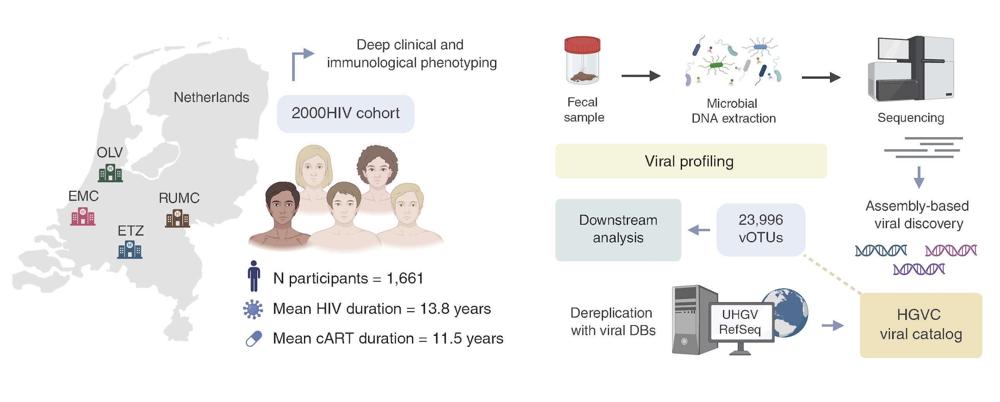

# Gut virome alterations in people living with HIV associate with host phenotypes and immune function
Gut virome characterization, strain sharing, and clinical associations in the **2000HIV study**.

<p align="center">
  
</p>

<table align="center">
<tr>

<td align="center" valign="top" style="padding-right:40px;">
<div style="margin-bottom:6px;"><b>Publication</b></div>
<a href="https://doi.org/10.64898/2026.03.05.709809"> 

</a>
</td>

<td align="center" valign="top" style="padding-left:40px;">
<div style="margin-bottom:6px;"><b>Viral catalogs</b></div>
<a href="https://doi.org/10.5281/zenodo.23530788">

</a>
</td>

</tr>
</table>

## Overview
Here, we present a comprehensive characterization of the **gut DNA virome in people with HIV (PWH)**, investigating its composition, strain sharing, and associations with behavioural, immunological, and clinical features in the 2000HIV study.

- 🧬 **Large-scale virome profiling:** We analyzed faecal shotgun metagenomes from 1,661 participants in the 2000HIV cohort, generating the [Human Gut Viral Catalog (HGVC)](https://fulab.web.rug.nl/HGVC/), which substantially expands known gut viral diversity in PWH.
  
- 🔗 **Sexual behaviour and viral sharing:** Men who have sex with men (MSM) showed increased viral diversity and a higher *Prevotella*/*Bacteroides* phage ratio. Viral strain sharing increased with the number of sexual partners and receptive anal sex, but did not mirror HIV phylogenetic relationships.

- 🛡️ **Immunological status and HIV history:** Specific viral populations were associated with immunological status, duration of HIV infection, and markers of viral control and persistence, including HIV controller status and HIV reservoir size.

- 💉 **COVID-19 vaccination and immune responses:** Viral community profiles differed by COVID-19 vaccination status, with these differences partly mediated by cytokine responses measured in ex vivo stimulation assays.
  
---

## Table of Contents
- [Cohort](#cohort)
- [Methods](#methods)
  - [Assembly](#assembly)
  - [Virus Identification and Abundance Profiling](#virus-identification-and-abundance-profiling)
  - [Virus Characterization](#virus-characterization)
  - [Strain-Level Profiling and Characterization of Shared Viruses](#strain-level-profiling-and-characterization-of-shared-viruses)
- [Data Availability](#data-availability)
- [Code Structure](#code-structure)
- [Citation](#citation)


---

## Cohort

This study is based on the 2000HIV cohort, a longitudinal study of PWH recruited between 2019 and 2021 from four HIV treatment centres and followed using extensive multi-omics profiling, immunological assays, and clinical assessments.

- **Original cohort description:** Vos W, Groenendijk A, et al. [The 2000HIV study: Design, multi-omics methods and participant characteristics](https://doi.org/10.3389/fimmu.2022.982746). *Frontiers in Immunology*, 2022.

---

## Methods

### Virus Identification and Abundance Profiling

Viral sequences were identified from assembled contigs generated using **metaSPAdes**.

- **Viral identification:** [geNomad](https://github.com/apcamargo/genomad) was used to identify viral sequences in the assembled contigs.
- **Prophage pruning and quality control:** Predicted prophage regions were initially pruned using geNomad. [CheckV](https://bitbucket.org/berkeleylab/checkv) was then used to remove host contamination, perform final prophage pruning, estimate viral genome completeness, and filter viral sequences.
- **Dereplication:** CheckV scripts (`anicalc.py` and `aniclust.py`) were used for dereplication against public viral genome databases: 95% ANI / 85% AF against the Gut Human Viral Catalogue (UHGV) and RefSeq.
- **Abundance estimation:** Quality-controlled reads were mapped to the dereplicated viral genome catalogue using [Bowtie2](http://bowtie-bio.sourceforge.net/bowtie2/).

---

### Virus Characterization and Strain-Level Profiling

- **Taxonomic classification:** Viral taxonomy was assigned using a hierarchical approach combining [RefSeq](https://www.ncbi.nlm.nih.gov/refseq/), [geNomad](https://github.com/apcamargo/genomad), and [VITAP](https://github.com/DrKaiyangZheng/VITAP).
- **Lifestyle prediction:** Bacteriophage lifestyles were predicted using [BACPHLIP](https://github.com/adamhockenberry/bacphlip).
- **Host prediction:** [iPHoP](https://bitbucket.org/srouxjgi/iphop/) was used to predict viral hosts, with host assignments summarized at the genus level.
- **Strain-level viral profiling:** [inStrain](https://github.com/MrOlm/inStrain) was used for strain-level comparisons, with strain sharing defined as population ANI (popANI) > 99.999%. Strain-sharing patterns were assessed in relation to sexual behaviour, including the number of sexual partners and receptive anal sex, and HIV phylogenetic clusters.

---

### *Caudoviricetes* and HIV Phylogenetic Analysis

- ***Caudoviricetes* phylogeny:** A maximum-likelihood phylogeny was reconstructed from concatenated alignments of conserved viral marker proteins, including the large terminase subunit, major capsid protein, and portal protein. Marker detection and alignment were performed using [HMMER](http://hmmer.org/), [MUSCLE](https://github.com/rcedgar/muscle), and [ClipKIT](https://github.com/JLSteenwyk/ClipKIT), followed by tree inference with [FastTree](http://www.microbesonline.org/fasttree/).
- **HIV phylogeny:** HIV *pol* sequences were amplified from CD4⁺ T-cell genomic DNA and sequenced using Sanger sequencing. Consensus sequences were aligned using [MAFFT](https://mafft.cbrc.jp/alignment/software/), and maximum-likelihood phylogenies were reconstructed using [IQ-TREE](https://www.iqtree.org/), with branch support assessed using 1,000 ultrafast bootstrap replicates and the approximate likelihood-ratio test. Putative transmission clusters were identified using [ClusterPicker](https://github.com/emmahodcroft/cluster-picker-and-cluster-matcher).

### Association and Mediation Analyses

- **Association analysis:** Associations between gut viral profiles and host phenotypes were assessed using [MaAsLin3](https://github.com/biobakery/Maaslin3), modelling viral abundance and prevalence separately and adjusting for relevant host and technical covariates. Models were additionally adjusted for the abundance of the predicted bacterial host genus where available.
- **Mediation analysis:** Causal mediation analysis was performed using the R package [mediation](https://cran.r-project.org/package=mediation) to assess whether cytokine levels mediated associations between host phenotypes and phage presence. Models accounted for relevant covariates, including predicted bacterial host abundance. Mediation effects were estimated using 1,000 quasi-Bayesian simulations.
---

## Data Availability

The HIV gut viral catalog (HGVC), associated metadata, and viral abundance table are available via [**Zenodo**](https://doi.org/10.5281/zenodo.23530788):

| File | Description | Link |
|------|-------------|------|
| `HGVC.fa.gz` | HGVC vOTU representative viral genomes (n=23,996) | [Download](https://zenodo.org/records/23530788/files/HGVC.fa.gz?download=1) |
| `HGVC_metadata.tsv` | Metadata for all HGVC species-level vOTUs | [Download](https://zenodo.org/records/23530788/files/HGVC_metadata.tsv?download=1) |
| `HGVC_only_all_genomes.fa.gz` | Gut viral genomes identified from samples in the 2000HIV study after deduplication (excluding external DBs) (n=60,538) | [Download](https://zenodo.org/records/23530788/files/HGVC_only_gut_vOTU_all_genomes.fa.gz?download=1) |

The datasets provide the inputs required to run the downstream analysis scripts in `scripts/F_Statistical_Downstream_analyses/`

---
## Code Structure
All scripts used in this project can be found within scripts and are organized as follows:

```text
scripts/
├── A_Virus_Identification/
│   ├── Contamination_quality_check/   # Quality control and contamination checks
│   └── Virus_detection/               # Viral sequence identification using geNomad
│
├── B_Dereplication/                   # Viral genome dereplication
│
├── C_Abundance_estimation/            # Viral abundance estimation through read mapping
│
├── D_Virus_Characterization/
│   ├── Genome_annotation/             # Viral genome annotation
│   ├── Host_and_lifestyle_prediction/ # Host prediction (iPHoP) and lifestyle prediction (BACPHLIP)
│   ├── Phylogeny/                     # Viral phylogenetic analyses
│   └── Taxonomy/                      # Viral taxonomy (geNomad, VITAP)
│
├── E_Strain_sharing/                  # Strain-level viral profiling and sharing analyses using inStrain
│
└── F_Statistical_Downstream_analyses/ # Statistical analyses, association testing, mediation and figure generation
```

---

## Citation

If you use this resource in your research, please cite both the associated publication and the data resource.

### Publication

> **Gut virome alterations in people living with HIV associate with host phenotypes and immune function**  
> Asier Fernández-Pato*, Haoran Peng*, Ángela Del Castillo-Izquierdo, Victoria Rios-Vazquez, Kavita Mehta, Rob J. W. Arts, Jéssica C. dos Santos, Mareva Delporte, Janneke E. Stalenhoef, Casper Rokx, Marvin A. H. Berrevoets, Leo A. B. Joosten, Mihai G. Netea, Alexander Kurilshikov, Linos Vandekerckhove, Andre J. A. M. van der Ven†, Alexandra Zhernakova† & Jingyuan Fu†
> bioRxiv (2026). To be added.

---

### Data resource

> Fernández Pato, A & Peng, H. (2026). **HIV Gut Viral Catalog (HGVC)(v1.0)** [Data set]. Zenodo.  
> [https://doi.org/10.5281/zenodo.23530788](https://doi.org/10.5281/zenodo.23530788)
>
> The catalog is also available through the [HGVC website](https://fulab.web.rug.nl/HGVC/).

---

## Contact

For questions regarding the analysis workflow or datasets, please feel free to [open an issue](https://github.com/GRONINGEN-MICROBIOME-CENTRE/2000HIV_Gut_Virome/issues) or contact: 

**Asier Fernández-Pato**  
University Medical Center Groningen  
📧 [a.fernandez.pato@umcg.nl](mailto:a.fernandez.pato@umcg.nl)

